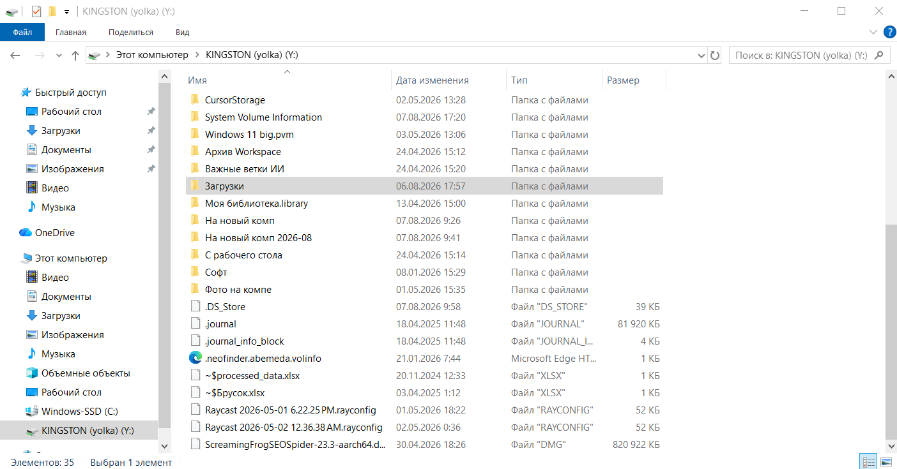

# 🌲 yolka


**Read-only Mac disk driver for Windows in pure Python — no kernel drivers, no dependencies.**

*yolka* (ёлка) is Russian for a spruce — the Christmas tree. An emoji spruce
in a folder name is what broke the paid driver and started this whole thing.


*An HFS+ drive from a Mac, mounted as drive Y: in Windows Explorer — labeled with its real volume name.*

Reads both Apple file systems — **APFS** (macOS 10.13+) and **HFS+** (Mac OS
Extended, the older one) — and mounts them as a regular Windows drive letter,
using the WebDAV client built into Windows itself. The format is detected
automatically.

[Читать по-русски →](README.ru.md)

## The story

A commercial APFS driver refused to open a folder from a Time Machine backup —
it choked on an emoji (`🌲`) in the folder name, a surrogate-pair bug in its
filename handling. The files I needed were locked inside. So this project reads
the file system directly from the raw disk, bypassing the driver entirely.
The spruce that broke everything gave the project its name.

**[Read the full story → STORY.md](STORY.md)** · [по-русски](STORY.ru.md)

## What it does

- parses APFS from raw bytes: GPT, checkpoints, object maps, B-trees;
- parses HFS+ too: catalog and extents B-trees, big-endian and all
  (validated on a real 1 TB HFS+ drive and on synthetic images);
- understands GPT and MBR partition tables alike;
- finds the latest valid APFS checkpoint (survives an unclean unmount);
- mounts the volume as a Windows drive letter via built-in WebDAV — browse
  in Explorer, open files in any app;
- CLI for scripted use: `ls`, `extract`, `info`;
- handles any filename: emoji, Cyrillic, surrogate pairs — the original bug
  that started it all;
- decompresses decmpfs/zlib files;
- **read-only by design** — it cannot damage your disk, period.

## Architecture

```
┌─ Explorer / any app
│      ↓  (drive letter, e.g. Y:)
├─ Windows WebDAV client        ← built into Windows, no install
│      ↓  HTTP on 127.0.0.1
├─ yolka.dav                    ← WebDAV server, ~200 lines, stdlib only
│      ↓
├─ yolka.apfs                   ← APFS parser: checkpoints, omaps, B-trees
│      ↓
├─ yolka.server                 ← raw-read server (one UAC prompt, then
│      ↓                          everything runs unprivileged)
└─ \\.\PhysicalDriveN           ← the actual disk
```

The elevation split matters: raw disk access on Windows requires administrator
rights, but nobody wants to run a file server elevated. `yolka.server` is a
50-line read-only proxy that takes the single UAC prompt; everything else runs
as a normal user.

## Installation

See **[INSTALL.md](INSTALL.md)** for the full guide. Short version: Windows 10/11,
Python 3.10+, zero third-party packages — clone and run.

## Usage

### The easy way — the GUI

```bash
python -m yolka.gui
```

A window lists your disks; hit «Mount» and the Mac drive appears on a free
drive letter under its real volume name. «Unmount» removes the letter and
shuts everything down. Admin rights are requested via a single UAC prompt
on mount.

### Or by hand, step by step

```bash
# 1. one UAC prompt (raw disk access):
python -m yolka.server \\.\PhysicalDrive1

# 2. as a normal user — mount as a drive:
python -m yolka.dav
net use Y: \\127.0.0.1@8809\DavWWWRoot

# ...or use the CLI without mounting:
python -m yolka info
python -m yolka ls "backup/Users/me/Documents"
python -m yolka extract "backup/Users/me/Documents/project" "C:\rescued"
```

Disk images need no elevation at all:

```bash
python -m yolka --image backup.img ls /
python -m yolka.dav --image backup.img
```

## Limitations

- no write support — intentional, forever;
- no FileVault (encrypted volumes);
- no lzvn/lzfse decompression yet (rare for user files);
- reads the current volume state (no snapshot selection yet).

## Roadmap

- [ ] lzfse/lzvn via pyliblzfse
- [ ] snapshot selection
- [ ] WinFsp backend as an alternative to WebDAV
- [ ] GUI: folder tree + extract button

## License

MIT
